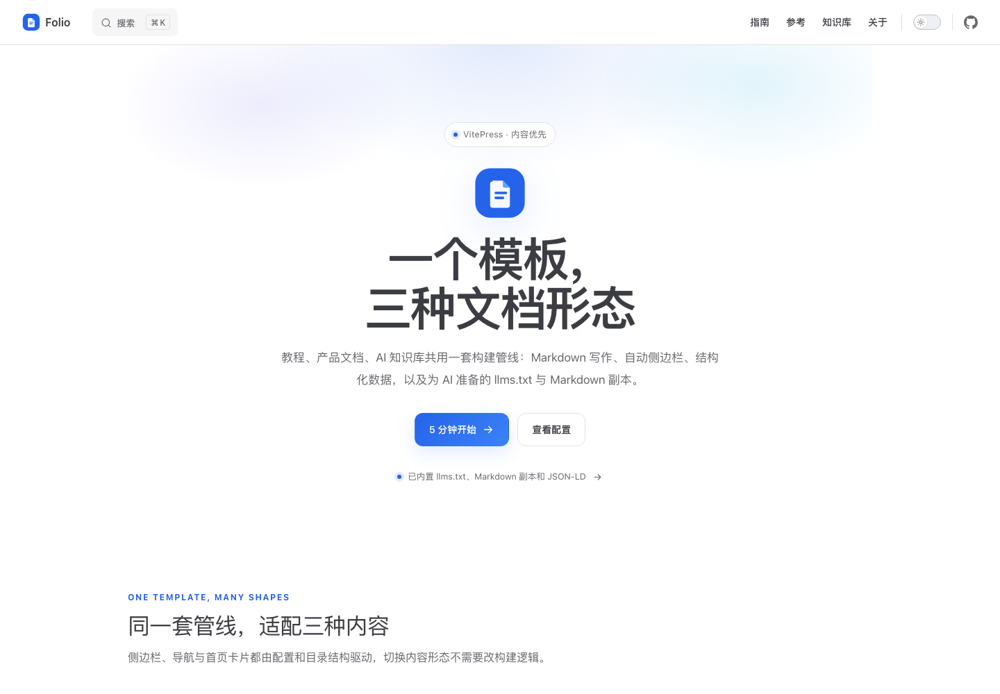
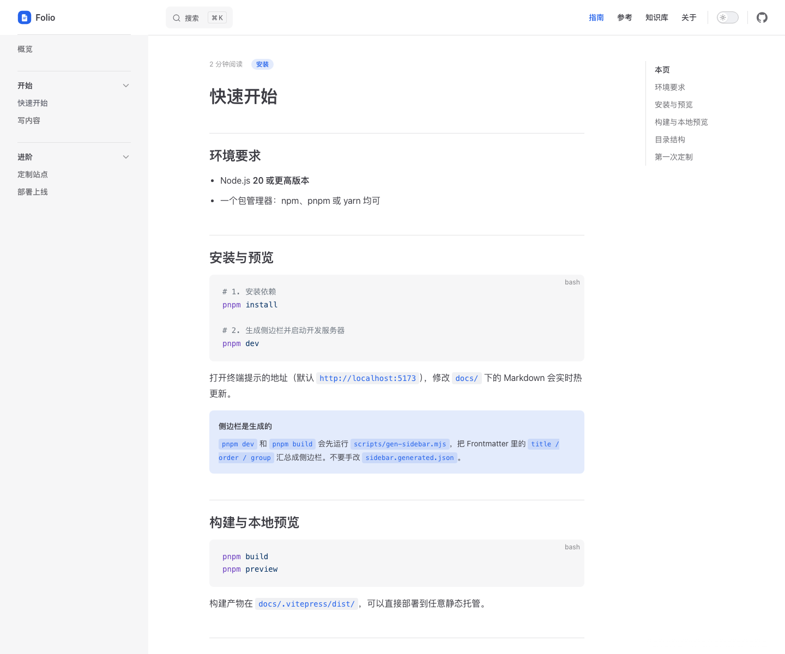

# Folio · 文档站模板

一个**内容优先**的 VitePress 模板：同一套代码可以做教程站、产品文档站或 AI 知识库。





- 示例：<https://docs.example.com>（占位）
- 技术栈：VitePress 1.x / Vue 3 / TypeScript / Markdown
- 无数据库、无后端，构建产物是纯静态文件

## 特性

- **配置驱动**：站点身份、导航、首页、功能开关各自一个入口。
- **自动侧边栏**：扫描 Frontmatter（`title / order / group`）生成分组侧边栏。
- **首页组件**：品牌、三种内容形态、能力清单、上手步骤。
- **文档体验**：阅读时长、更新时间、标签、阅读进度条、文末导航、复制 Markdown。
- **AI 就绪**：`llms.txt`、`llms-full.txt`、逐页 `.md`、JSON-LD、AI 爬虫白名单。
- **SEO**：canonical、OG/Twitter、sitemap、可选搜索引擎验证。
- **本地搜索**：MiniSearch，无需外部服务。
- **一键部署**：Cloudflare Pages 与 EdgeOne Makers 脚本，附缓存 / 安全 / 重定向配置。
- **可选统计**：Umami，同源反代规避广告拦截。

## 快速开始

要求 Node.js 20+。

```bash
pnpm install
pnpm dev       # 本地开发
pnpm build     # 构建到 docs/.vitepress/dist
pnpm preview   # 预览产物
```

也可以使用 `npm install` / `npm run dev`。

## 目录

```text
.
├─ docs/
│  ├─ .vitepress/
│  │  ├─ config.mts          # VitePress + 主题配置
│  │  ├─ site.config.ts      # 站点身份、页脚、功能开关
│  │  ├─ sections.json       # 分区（导航 + 侧边栏）
│  │  ├─ home.ts             # 首页文案
│  │  ├─ seo.ts              # JSON-LD / llms.txt / Markdown 副本
│  │  └─ theme/              # 自定义主题与组件
│  ├─ guide/                 # 教程示例
│  ├─ reference/             # 参考示例
│  ├─ kb/                    # 知识库示例
│  └─ public/                # logo.svg、og.png、静态资源
├─ scripts/
│  ├─ gen-sidebar.mjs        # 生成侧边栏
│  ├─ new.mjs               # 创建新页面
│  ├─ edgeone.mjs           # EdgeOne 产物与统计反代
│  └─ deploy.mjs            # 部署入口
├─ .env.example
├─ redirects.json
└─ package.json
```

## 开始定制

1. `docs/.vitepress/site.config.ts`：站名、描述、作者、域名、编辑链接。
2. `docs/.vitepress/sections.json`：分区与顶部导航。
3. `docs/.vitepress/home.ts`：首页文案与按钮。
4. `docs/public/logo.svg`、`docs/public/og.png`：品牌与分享图。
5. 删除 `docs/guide|reference|kb` 下的示例，写自己的内容。

创建页面：

```bash
npm run new -- guide/my-page "我的页面"
```

## 内容约定

```yaml
---
title: 快速开始
description: 一句话说明这篇文档解决什么问题。
order: 1
group: 开始
tags: [安装]
date: 2026-01-01
---
```

- 每个文件一个 H1，正文从 `##` 开始。
- 站内链接使用根路径：`/guide/getting-started`。
- 静态文件放 `docs/public/`，引用 `/logo.svg`。
- `description` 会用于 SEO、OG 和 `llms.txt`。

## 部署

```bash
cp .env.example .env
# 填写 SITE_URL 与平台 token
npm run deploy:cloudflare
npm run deploy:edgeone
npm run deploy            # 两个平台都发
```

- Cloudflare Pages：`wrangler pages deploy`。
- EdgeOne Makers：`edgeone makers deploy`，自动生成 `edgeone.json` 与统计反代函数。
- 任意静态托管也可：上传 `docs/.vitepress/dist/`。
- 详细步骤见 `docs/guide/deploying.md`。

> `cleanUrls: true` 需要托管平台把 `/guide/x` 映射到 `/guide/x.html`；Cloudflare Pages 与 EdgeOne Pages 默认支持。

## 构建产物

`docs/.vitepress/dist/` 包含 HTML、assets、`sitemap.xml`、`robots.txt`、`llms.txt`、`llms-full.txt` 和逐页 `.md`。

## 从模板创建仓库

1. 在 GitHub 上点 **Use this template**（或 fork）。
2. 修改 `package.json` 的 `name` 与 `site.config.ts`。
3. 更新 `README.md`、`LICENSE` 中的作者信息。
4. 配置仓库 Secrets：`CLOUDFLARE_API_TOKEN`、`CLOUDFLARE_ACCOUNT_ID`、`CF_PAGES_PROJECT`、`SITE_URL`。
5. 在仓库 **Actions → Deploy → Run workflow** 手动触发部署（默认不随 push 自动运行，避免缺少 Secrets 时失败）。

## 许可证

[MIT](./LICENSE) © 2026 Your Name
